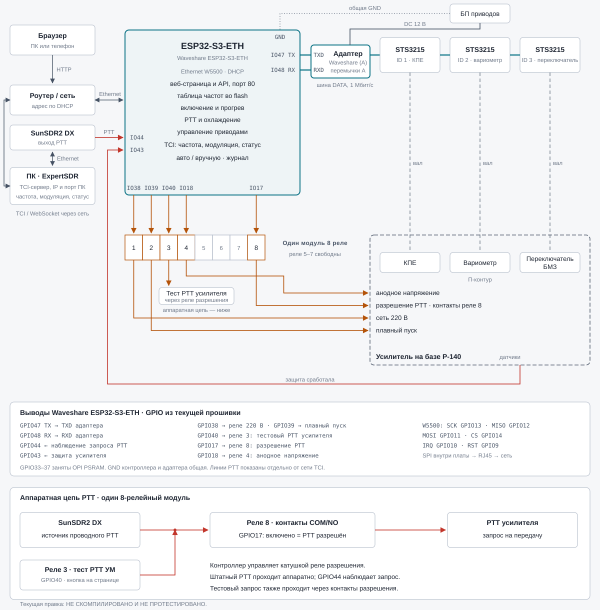
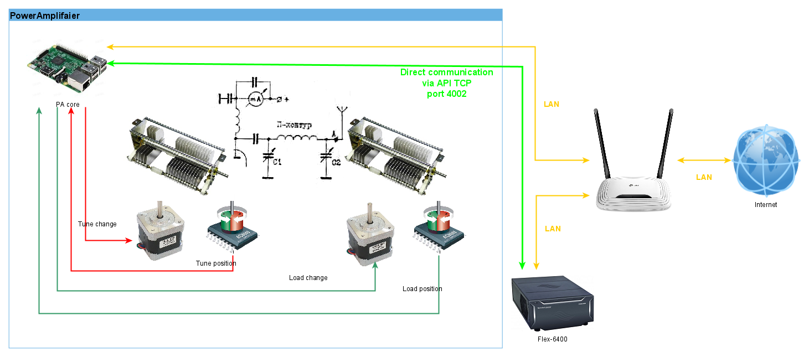

# RemoteTubeAmplifaier

[Русская версия](README.md)

> **Current PTT / single 8-relay module change: NOT COMPILED AND NOT TESTED.** Firmware builds, tests and hardware checks were not run, as requested by the user.



The diagram with the power-up sequence and the pin table (in Russian): [docs/scheme.html](docs/scheme.html).

**User manual** (in Russian: assembly, first start, operation): [docs/manual/manual.pdf](docs/manual/manual.pdf),
LaTeX source `docs/manual/manual.tex`, build with `docs/manual/build.sh`.

A Waveshare ESP32-S3-ETH controller for a vacuum tube power amplifier based on the R-140. It retunes the pi-network
(variable capacitor, variometer, band switch) to the selected frequency, controls the amplifier
power-up sequence and PTT enable. Operation and tuning are done from a web page served by the
controller itself.

> Work in progress. The current board is Waveshare ESP32-S3-ETH; the user has confirmed a TCI
> connection. A complete check with servos, relays and the amplifier is still required — see [Project status](#project-status).

## Features

- **Frequency table** in 25 kHz steps across the 160–10 m amateur bands and the 190 m (1600–1775 kHz) and 100 m (2900–3200 kHz) bands; one band is shown at a time.
- **Frequency-based retuning**: selecting a frequency moves the variable capacitor, the variometer and the band switch to the positions saved for it. Frequency selection and tuning work only with the amplifier on and warmed up.
- **SunSDR2 DX / TCI**: the controller receives frequency, modulation and radio state from ExpertSDR on a computer. Auto selects a memory covering ±12.5 kHz; in Auto + Tuning mode a memory click sets its center frequency on the radio.
- **Tuning mode**: the capacitor and the variometer are turned with sliders and ±1/±10/±100 step buttons, the band switch with buttons 1–5; the best setting is saved for the frequency.
- **Power-up sequence**: "On" → 220 V relay → 10 s soft start (short-circuit the start-up resistor) → 4-minute tube warm-up (controls locked) → anode voltage → PTT enable.
- **Hardware PTT permission**: the transceiver drives the amplifier PTT through the NO contacts of relay 8. The ESP32 energizes this permission relay when transmission is allowed, independently of the current PTT request; GPIO44 observes the request. Warmup, protection, memory and servo interlocks determine permission.
- **Amplifier PTT test**: the page's "Тест PTT усилителя" button activates relay 3, which supplies a test request through the same permission relay. It does not key the transceiver. A page confirmation is required every 0.5 s; the test releases after 2 s without confirmation and has a 60 s limit. All PTT interlocks apply to the test.
- **Cool-down**: if less than 5 minutes have passed since the last transmission, "Switch off" does not switch the amplifier off; a "Switch off without cool-down" button appears instead.
- **Protection**: a trip drops the anode voltage and blocks PTT (latched until reset from the web page).
- **Status on the page**: power-up stage with countdown, mains, anode, PTT and the reason it is blocked, time since the last transmission and cool-down countdown, protection, link to each servo.
- **Service**: servo bus scan, servo ID change, bringing the band switch to zero (position 1).
- **Settings storage** in the ESP32 flash; the table can be downloaded to a file and uploaded back (to move it to another board).
- Layout for desktop and phone.

## Hardware

| Part | What is used |
|---|---|
| Controller | Waveshare ESP32-S3-ETH (ESP32-S3, 16 MB flash, 8 MB PSRAM); Ethernet W5500, DHCP |
| Transceiver | SunSDR2 DX; TCI connection through ExpertSDR on a computer |
| Variable capacitor | Feetech STS3215 servo, ID 1, 190° (180° + 10° margin) |
| Variometer | Feetech STS3215 servo, ID 2, 190° (180° + 10° margin) |
| Band switch | Feetech STS3215 servo, ID 3, 5 positions 180° apart (half a servo turn per step), no end stops |
| Switching | one optocoupled 8-relay module |
| Network | Ethernet on W5500, address via DHCP; Wi-Fi disabled |

The board's RJ45 connects to its built-in W5500. The controller, the computer running ExpertSDR
and SunSDR2 DX connect to the local network. ExpertSDR hosts the TCI server: enter the computer's
IP address and TCI port in the controller settings.

## Wiring

Pins for the Waveshare ESP32-S3-ETH. All relays are switched on by a **low** level at the module input.
GPIO33–37 on this board are used by the PSRAM (OPI) and are unavailable.

| ESP32 pin | Function |
|---|---|
| IO38 | relay 1 (8-relay module): 220 V mains |
| IO39 | relay 2: soft start (short-circuit the start-up resistor) |
| IO40 | relay 3: amplifier test PTT request |
| IO17 | relay 8: PTT permission; NO contacts in series with the amplifier PTT request |
| IO18 | relay 4: anode voltage |
| IO44 | input: transceiver PTT (active when pulled to GND) |
| IO43 | input "protection tripped" (active when pulled to GND) |
| IO47 | servo bus, transmit (to adapter `TXD`) |
| IO48 | servo bus, receive (to adapter `RXD`) |
| IO13 / IO12 / IO11 | built-in W5500 SPI: SCK / MISO / MOSI |
| IO14 / IO10 / IO9 | built-in W5500: CS / IRQ / RST |

IO labels are ESP32 GPIO numbers, not connector contact numbers. The W5500 signals are already wired inside the board and reserved for Ethernet.

Relays 5–7 of the single 8-relay module are free. Relay 4 uses GPIO18; GPIO41 is no longer assigned to relay 4.
Pins are set by constants at the top of the sketch.

### Servo bus

All three STS3215 share one half-duplex bus (1 Mbit/s): each servo has two parallel connectors,
and the servos are daisy-chained.

The servos are connected to the ESP32 through a Waveshare Bus Servo Adapter (A):

```
ESP32 IO47 (TX) ─── TXD ┐
ESP32 IO48 (RX) ─── RXD ├ adapter (jumpers in position A) ── servo port ── servo ── servo ── servo
ESP32 GND ───────── GND ┘                │
                                         └── DC 12 V (servo power supply)
```

- **TX to TXD, RX to RXD**: the adapter labels are from the controller side, this is not a mistake.
- **Jumpers** on the 6-pin header in position A: the RXD/TXD row is connected to the middle row (U1RXD/U1TXD). In position B the bus is driven by a computer through the adapter's USB-C (handy for testing servos and changing IDs).
- **Servo power**: a supply at the servo voltage (12 V for 12 V STS3215, check the label) with enough current (up to 2–3 A per servo when stalled). The adapter is rated 9–12.6 V; at 14.5 V the servo reports a voltage error. Do not power the servos from the ESP32.
- **Common ground** between the adapter and the ESP32 is required (GND pin of the UART header).
- The adapter UART header uses 3.3 V levels, no level shifting needed. The adapter does not provide 5 V for the ESP32.

### Relays and inputs

The normal signal path is **transceiver PTT → relay 8 COM/NO contacts → amplifier PTT**. The ESP32 controls permission, while the request passes in hardware. Relay 3 contacts provide a separate test request before the permission relay. GPIO44 observes PTT. The transmission indicator and cool-down timer use the presence of a request with permission granted; there is no sensor confirming the amplifier relay's physical state.

- "Arduino" relay modules are designed for 5 V. If the relays do not switch reliably from 3.3 V, power the optocoupler side (VCC) from 3.3 V and the coils (JD-VCC) from 5 V with the jumper removed.
- Never apply more than 3.3 V to IO44/IO43: bring the transceiver PTT and the amplifier signals in through a dry contact or an optocoupler to GND.

## Build and flash

You need [arduino-cli](https://arduino.github.io/arduino-cli/) (or the Arduino IDE) and the ESP32
core 3.x (`esp32:esp32`). TCI requires WebSockets by Links2004, version 2.7.2:

```bash
arduino-cli lib install "WebSockets@2.7.2"
```

1. For Wi-Fi only (`USE_ETHERNET 0`), create `esp32-backend/secrets.h` (it is in `.gitignore`). Ethernet builds do not need this file:

   ```cpp
   #pragma once
   const char *WIFI_SSID = "network name";  // the ESP32 supports 2.4 GHz only
   const char *WIFI_PASS = "password";
   ```

2. Build the firmware and upload it together with the web page files (`esp32-backend/data`) with one command:

   ```bash
   tools/flash.sh               # build, upload firmware and page files
   tools/flash.sh build         # build only
   tools/flash.sh firmware      # build and upload the firmware only
   tools/flash.sh www           # upload the page files only
   tools/flash.sh monitor       # serial monitor
   tools/flash.sh -p /dev/ttyACM1 all   # another port
   ```

   Close the serial monitor before uploading. Later the files can be updated without a cable: "Service" block on the page → "Upload files". If the files are missing (for example, after a full flash erase), the board serves a fallback page with an upload form.

3. Open the serial monitor (`tools/flash.sh monitor`): the board prints the address it got from the router, `IP: 192.168.x.x`. Open it in a browser. It is convenient to reserve this address for the board in the router settings.

The current sketch already selects `#define USE_ETHERNET 1`; its `ETH_*` pins match the built-in W5500 on Waveshare ESP32-S3-ETH.

Servo speed and acceleration are the `SERVO_SPEED` and `SERVO_ACC` constants; warm-up
and cool-down durations are `WARMUP_MS` and `COOLDOWN_MS`.

> For debugging, warm-up and cool-down are currently shortened to 10 s (`WARMUP_MS`, `COOLDOWN_MS`, marked "ОТЛАДКА").
> Set them back to 240000 (4 minutes) and 300000 (5 minutes) before running the amplifier.

## First start

1. **Servo IDs.** All servos ship with ID 1. Connect them to the bus one at a time and change the ID in the "Service" block of the page: variometer to 2, band switch to 3. The capacitor stays at 1. "Find servos" shows which servos respond.
2. **Band switch calibration.** Servo zero is switch position 1. In the "Service" block press "Bring to zero" and set the switch mechanically to position 1 (couple it at servo zero). The other positions are 180° apart (half a servo turn per step).
3. **Frequency tuning.** Turn on "Tuning mode", select a frequency, adjust the capacitor, the variometer and the band switch position, press "Save". Tuned frequencies are marked with a green bar.
4. **Backup.** In tuning mode, "Download" saves the table to `tubeamp-points.csv` (`frequency;capacitor;variometer;switch`), "Upload" restores it.

## SunSDR2 DX over TCI

Enable the TCI server in ExpertSDR on your computer. In the amplifier page, enable Tuning mode and enter the **computer's IPv4 address** and the configured TCI port (initial form value: 50001) in the SunSDR2 DX / TCI section. Enable the connection and save. Settings persist in ESP32 flash; they can be edited while the amplifier is off. Allow access to the TCI port through the computer's firewall if needed.

The main page shows TCI connection status, radio on/off/unknown, frequency in MHz to 1 Hz and modulation for **RX1 / VFO A**. The radio frequency and the amplifier's selected memory frequency are displayed separately. The ESP32 connects even when no browser is open, retries every 5 seconds after failures and uses a WebSocket heartbeat. A successful connection does not imply that the radio is on: its state is unknown until START/STOP is received. Frequency and modulation are hidden when disconnected or stopped.

Connection settings are separate from the servo settings CSV. Update all three page files together with the firmware (API 9).

## Position control modes

**Вручную** (Manual) and **Авто по TCI** (Auto via TCI) are independent of the **Режим настройки** (Tuning mode) checkbox. The control mode persists in flash; the initial default is Manual.

Manual mode selects amplifier memories with page buttons. Tuning mode additionally enables servo controls and saving. Auto follows RX1 / VFO A: each memory covers ±12.5 kHz around its frequency, with the higher memory winning a shared boundary. An unconfigured memory is never replaced with an adjacent configured one.

Auto blocks amplifier PTT and the amplifier PTT test button when the radio is unavailable, off or unknown, frequency is missing, the matching memory is not fully saved (capacitor, variometer and switch), a frequency request is pending, or retuning has not finished. Existing warmup, protection and servo fault interlocks remain active, including in Tuning mode. Use Manual for initial tuning of an unsaved memory under a carrier.

If the memory changes during transmission, amplifier PTT drops and movement waits for the radio PTT to be released. Auto applies the current memory after warmup; it does not follow frequency with the amplifier off. Changes within the same memory do not resend motor targets.

In Auto + Tuning mode, clicking a memory sends its center frequency to the radio. Motors apply the memory after a fresh TCI frequency confirmation. Turning the radio dial never snaps its frequency to a memory center. Failed requests keep PTT blocked; retry the selection. Leaving Tuning mode, changing control mode or connection settings cancels pending requests; queued commands do not carry into a new connection.

## Web journal

Open **Журнал** (Journal), then check **Записывать логи** (Record logs). This setting persists in flash and is restored before network and TCI startup. The journal records startup, network, amplifier and servo events, TCI connection/frequency/modulation changes and API errors. Timestamps show uptime since ESP32 startup.

The journal refreshes every second while its tab is open. **Скачать логи** downloads `tubeamp-log.txt`. Disabling recording keeps existing messages available. RAM holds the latest 64 lines, up to 255 bytes per line, replacing old lines when full. Messages start fresh after reboot; only the checkbox is saved in flash. Update the firmware and all three page files together (API 9).

## HTTP API

Responses are JSON. Capacitor and variometer positions are in steps 0..2162 (190° = 180° travel + 10° margin).

| Method | Purpose |
|---|---|
| `GET /api/state` | full current state: frequency, positions, mode, power-up stage, relays, inputs, PTT, servo links |
| `POST /api/tci` | save form-urlencoded `host`, `port`, `enabled=0\|1` in tuning mode; returns current state |
| `GET /api/logs`, `GET /api/logs/download` | current UTF-8 journal; the second address downloads a text file |
| `POST /api/logs?enabled=0\|1` | persist recording setting; returns state with `logsEnabled` |
| `GET /api/table` | bands and points `[frequency, capacitor, variometer, saved, switch]` |
| `POST /api/select?freq=<kHz>` | select a frequency |
| `POST /api/mode?tuning=0\|1` | tuning mode |
| `POST /api/control?mode=manual\|auto` | persist the position control mode |
| `POST /api/move?cap=&vario=&sw=` | manual control (tuning mode only) |
| `POST /api/save`, `POST /api/reset` | save or reset the setting for the current frequency |
| `GET /api/points.csv`, `POST /api/points.csv` | table download and upload |
| `POST /api/power?on=0\|1[&force=1]` | switch the amplifier on or off; within 5 minutes after a transmission, switching off needs `force=1` |
| `POST /api/protection/reset` | reset a latched protection trip |
| `POST /api/tx?on=1`, `?keep=1`, `?on=0` | transmit from the web page: start, confirm (at least every 2 s), stop |
| `POST /api/www` | upload web page files (multipart) |
| `POST /api/servo/scan`, `POST /api/servo/id?from=&to=` | servo scan and ID change |
| `POST /api/switch/zero` | bring the band switch servo to zero (position 1) |

The `tci` object in `/api/state` contains `host`, `port`, `enabled`, `link` (`disabled`, `connecting`, `connected`, `disconnected`, `error`), `running` (boolean or null), `frequency` (Hz or null) and `modulation` (string or null). Frequency and modulation are null when disconnected or stopped. Until START/STOP arrives, `running` is null while live frequency and modulation may be available.

## Project status

**The current PTT change has not been compiled or tested.** Build and test results below refer to the previous revision.

The current hardware is Waveshare ESP32-S3-ETH with W5500 Ethernet and SunSDR2 DX through
the ExpertSDR TCI server on a computer. The user has confirmed a TCI connection. The firmware
builds for ESP32-S3 in C++17; memory-selection, TCI-protocol, journal and page-logic tests pass.
Servo operation through the adapter, ID scan/change, movement and power-loss recovery were checked earlier.

The servos can be tested from a PC without the ESP32: adapter jumpers in position B, USB-C to the PC,
`tools/sts-servo.py scan` (find), `regs ID` (registers), `goto ID GOAL` (move), `powercut ID` (power loss
during rotation). Requires pyserial.

A complete test of automatic retuning on the current board with servos, relays, PTT/protection inputs
and the amplifier is still needed. The servos are unavailable in the user's latest check.
TCI frequency reception, Manual/Auto modes and setting the radio frequency from a memory are implemented.

## Previous version

The `py_server/`, `py_client/` and `common/` directories are the previous generation of the
project: a Raspberry Pi with stepper motors and Mechaduino boards, retuning to the frequency of a
Flex-6400 transceiver. It is no longer developed.


