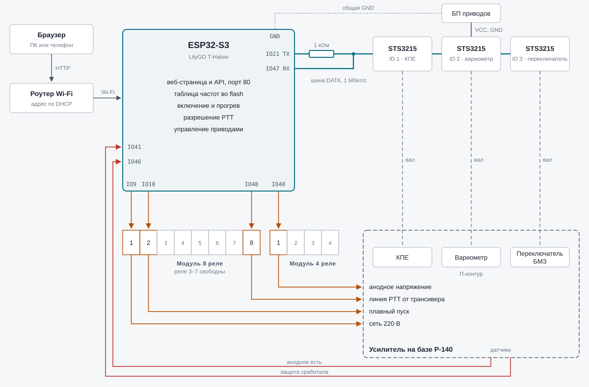
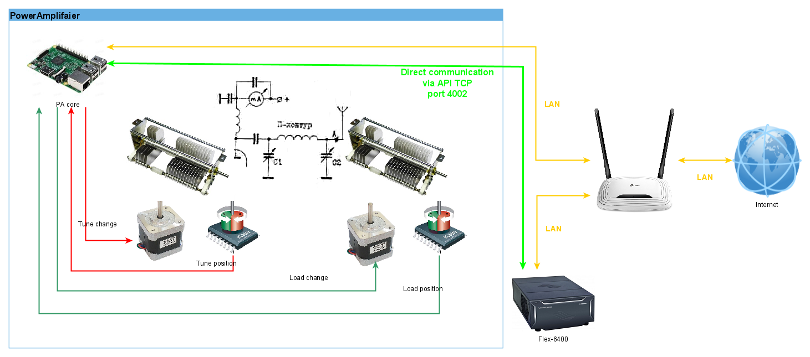

# RemoteTubeAmplifaier

[Русская версия](README.md)



The diagram with the power-up sequence and the pin table (in Russian): [docs/scheme.html](docs/scheme.html).

An ESP32 controller for a vacuum tube power amplifier based on the R-140. It retunes the pi-network
(variable capacitor, variometer, band switch) to the selected frequency, controls the amplifier
power-up sequence and PTT enable. Operation and tuning are done from a web page served by the
controller itself.

> Work in progress. The logic and the web interface have been tested on the board, but the servos,
> relays and amplifier inputs have not been connected to it yet — see [Project status](#project-status).

## Features

- **Frequency table** in 25 kHz steps across the 160–10 m amateur bands and the 100 m band (2900–3200 kHz); one band is shown at a time.
- **Frequency-based retuning**: selecting a frequency moves the variable capacitor, the variometer and the band switch to the positions saved for it.
- **Tuning mode**: the capacitor and the variometer are turned with sliders and ±1/±10/±100 step buttons, the band switch with buttons 1–5; the best setting is saved for the frequency.
- **Power-up sequence**: mains on → soft start bypass after 5 s → 3-minute tube warm-up (controls locked) → anode voltage → PTT enable.
- **PTT through the controller**: the transceiver PTT goes into the ESP32 and reaches the amplifier only after warm-up, with anode voltage present and no protection trip; PTT is dropped while the band switch is rotating.
- **Transmit from the web page**: the "Transmit" button keys the transceiver (relay 3), only when the amplifier is on and warmed up; the page confirms the transmission every 0.5 s, without confirmation it is released after 2 s, and it never lasts longer than 60 s.
- **Cool-down**: if less than 5 minutes have passed since the last transmission, "Switch off" does not switch the amplifier off; a "Switch off without cool-down" button appears instead.
- **Protection**: a trip is latched and PTT stays disabled until it is reset from the web page.
- **Status on the page**: power-up stage with countdown, mains, soft start, anode, PTT and the reason it is blocked, time since the last transmission and cool-down countdown, protection, link to each servo.
- **Service**: servo bus scan, servo ID change, band switch position 1 calibration.
- **Settings storage** in the ESP32 flash; the table can be downloaded to a file and uploaded back (to move it to another board).
- Layout for desktop and phone.

## Hardware

| Part | What is used |
|---|---|
| Controller | LilyGO T-Halow (ESP32-S3, 16 MB flash); a move to an ESP32-S3 board with Ethernet is planned |
| Variable capacitor | Feetech STS3215 servo, ID 1 |
| Variometer | Feetech STS3215 servo, ID 2 (rotates without limits) |
| Band switch | Feetech STS3215 servo, ID 3, 5 positions 72° apart, no end stops |
| Switching | 8-relay optocoupled module + 4-relay module |
| Network | Wi-Fi client (DHCP); an Ethernet (W5500) build option exists but is untested |

The RJ45 jack on the T-Halow belongs to its HaLow module; the ESP32 has no access to it.

## Wiring

Pins for the T-Halow. All relays are switched on by a **low** level at the module input.

| ESP32 pin | Function |
|---|---|
| IO9 | relay 1 (8-relay module): amplifier mains |
| IO10 | relay 2: soft start bypass |
| IO12 | relay 3: transceiver PTT (transmit from the web page) |
| IO48 | relay 8: amplifier PTT |
| IO40 | relay 1 (4-relay module): anode voltage |
| IO11 | input: transceiver PTT (active when pulled to GND) |
| IO41 | input "protection tripped" (active when pulled to GND) |
| IO46 | input "anode voltage present" (active when pulled to GND) |
| IO21 | servo bus, transmit (through a 1 kΩ resistor) |
| IO47 | servo bus, receive |

Relays 4–7 of the 8-relay module and 2–4 of the 4-relay module are currently free. Pins are set by constants at the top of the sketch.

### Servo bus

All three STS3215 share one half-duplex bus (1 Mbit/s): each servo has two parallel connectors,
and the servos are daisy-chained.

```
ESP32 IO21 (TX) ──[ 1 kΩ ]──┬──── servo DATA
ESP32 IO47 (RX) ────────────┘
ESP32 GND ───────────────────────── servo GND ── power supply negative
                                    servo VCC ── power supply positive
```

- **Servo power**: a separate supply at the servo voltage (7.4 V or 12 V — check the label) with enough current (up to 2–3 A per servo when stalled). Do not power the servos from the ESP32.
- **Common ground** between the servo supply and the ESP32 is required.
- **Data line level**: before connecting to the ESP32, measure the voltage between DATA and GND on a powered servo. ESP32 pins are 3.3 V; if the line sits at about 5 V, use a level shifter or a ready-made adapter (Feetech FE-URT-1, Waveshare Bus Servo Adapter).

### Relays and inputs

- "Arduino" relay modules are designed for 5 V. If the relays do not switch reliably from 3.3 V, power the optocoupler side (VCC) from 3.3 V and the coils (JD-VCC) from 5 V with the jumper removed.
- Never apply more than 3.3 V to IO11/IO41/IO46: bring the transceiver PTT and the amplifier signals in through a dry contact or an optocoupler to GND.

## Build and flash

You need [arduino-cli](https://arduino.github.io/arduino-cli/) (or the Arduino IDE) and the ESP32
core 3.x (`esp32:esp32`). No third-party libraries are required.

1. Create `esp32-backend/secrets.h` (it is in `.gitignore`):

   ```cpp
   #pragma once
   const char *WIFI_SSID = "network name";  // the ESP32 supports 2.4 GHz only
   const char *WIFI_PASS = "password";
   ```

2. Build the firmware and upload it together with the web page files (`esp32-backend/data`) with one command:

   ```bash
   tools/flash.sh               # build, upload firmware and page files
   tools/flash.sh build         # build only
   tools/flash.sh firmware      # build and upload the firmware only
   tools/flash.sh www           # upload the page files only
   tools/flash.sh monitor       # serial monitor
   tools/flash.sh -p /dev/ttyACM1 all   # another port
   ```

   Close the serial monitor before uploading. Later the files can be updated without a cable: "Service" block on the page → "Upload files". If the files are missing (for example, after a full flash erase), the board serves a fallback page with an upload form.

3. Open the serial monitor (`tools/flash.sh monitor`): the board prints the address it got from the router, `IP: 192.168.x.x`. Open it in a browser. It is convenient to reserve this address for the board in the router settings.

For a board with Ethernet (W5500), set `#define USE_ETHERNET 1` at the top of the sketch and set the `ETH_*` pins.

Servo speed and acceleration are the `SERVO_SPEED` and `SERVO_ACC` constants; soft start,
warm-up and cool-down durations are `SOFTSTART_MS`, `WARMUP_MS` and `COOLDOWN_MS`.

> For debugging, warm-up and cool-down are currently shortened to 10 s (`WARMUP_MS`, `COOLDOWN_MS`, marked "ОТЛАДКА").
> Set them back to 180000 and 300000 before running the amplifier.

## First start

1. **Servo IDs.** All servos ship with ID 1. Connect them to the bus one at a time and change the ID in the "Service" block of the page: variometer to 2, band switch to 3. The capacitor stays at 1. "Find servos" shows which servos respond.
2. **Band switch calibration.** In the "Service" block, turn the switch exactly to position 1 with the slider and the ±1/±10/±100 buttons and press "Remember as position 1".
3. **Frequency tuning.** Turn on "Tuning mode", select a frequency, adjust the capacitor, the variometer and the band switch position, press "Save". Tuned frequencies are marked with a green bar.
4. **Backup.** In tuning mode, "Download" saves the table to `tubeamp-points.csv` (`frequency;capacitor;variometer;switch`), "Upload" restores it.

## HTTP API

Responses are JSON. Servo positions are in steps 0..4095 (4096 steps per revolution).

| Method | Purpose |
|---|---|
| `GET /api/state` | full current state: frequency, positions, mode, power-up stage, relays, inputs, PTT, servo links |
| `GET /api/table` | bands and points `[frequency, capacitor, variometer, saved, switch]` |
| `POST /api/select?freq=<kHz>` | select a frequency |
| `POST /api/mode?tuning=0\|1` | tuning mode |
| `POST /api/move?cap=&vario=&sw=` | manual control (tuning mode only) |
| `POST /api/save`, `POST /api/reset` | save or reset the setting for the current frequency |
| `GET /api/points.csv`, `POST /api/points.csv` | table download and upload |
| `POST /api/power?on=0\|1[&force=1]` | switch the amplifier on or off; within 5 minutes after a transmission, switching off needs `force=1` |
| `POST /api/protection/reset` | reset a latched protection trip |
| `POST /api/tx?on=1`, `?keep=1`, `?on=0` | transmit from the web page: start, confirm (at least every 2 s), stop |
| `POST /api/www` | upload web page files (multipart) |
| `POST /api/servo/scan`, `POST /api/servo/id?from=&to=` | servo scan and ID change |
| `POST /api/switch/move?pos=`, `POST /api/switch/jog?steps=`, `POST /api/switch/calibrate` | band switch calibration |

## Project status

Tested on the T-Halow: Wi-Fi with DHCP, the web page, all API methods, settings storage in flash,
the power-up sequence and PTT blocking logic.

Not yet tested on hardware:
- the STS3215 servos (the protocol is implemented from the Feetech documentation), including the band switch step mode;
- the relays and the PTT, protection and anode inputs;
- the Ethernet build.

Not implemented: reading the frequency from the transceiver over CAT.

## Previous version

The `py_server/`, `py_client/` and `common/` directories are the previous generation of the
project: a Raspberry Pi with stepper motors and Mechaduino boards, retuning to the frequency of a
Flex-6400 transceiver. It is no longer developed.


