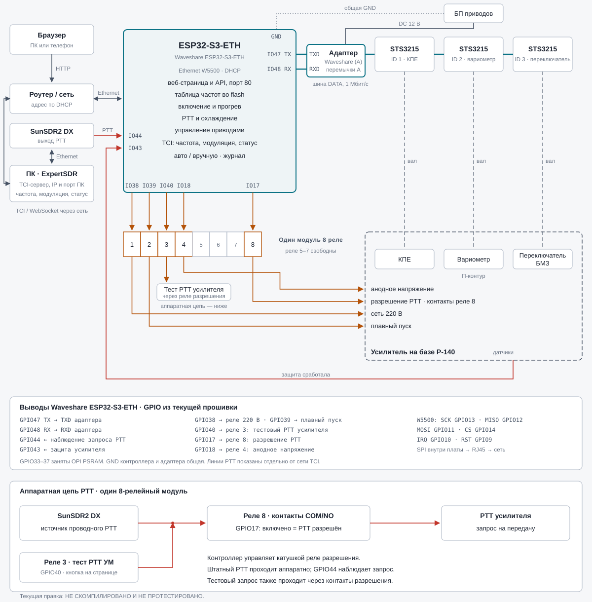
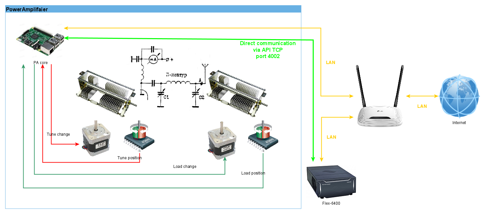

# RemoteTubeAmplifaier

[English version](README.en.md)

> **Текущая правка PTT и раскладки одного 8-релейного модуля: НЕ СКОМПИЛИРОВАНО И НЕ ПРОТЕСТИРОВАНО.** Сборка прошивки, тесты и проверка на плате по просьбе пользователя не запускались.



Схема с последовательностью включения и таблицей выводов: [docs/scheme.html](docs/scheme.html).

**Руководство пользователя** (сборка, запуск, работа): [docs/manual/manual.pdf](docs/manual/manual.pdf),
исходник в LaTeX — `docs/manual/manual.tex`, сборка — `docs/manual/build.sh`.

Контроллер лампового усилителя мощности на базе Р-140 на плате Waveshare ESP32-S3-ETH. Автоматически перестраивает
П-контур (КПЕ, вариометр, переключатель БМЗ) по выбранной частоте, управляет включением
усилителя и разрешением PTT. Работа и настройка — через веб-страницу, которую отдаёт сам контроллер.

> Проект в разработке. Текущая плата — Waveshare ESP32-S3-ETH; подключение к TCI подтверждено
> пользователем. Полная проверка с приводами, реле и усилителем ещё требуется — см. [Состояние проекта](#состояние-проекта).

## Возможности

- **Таблица частот** с шагом 25 кГц по любительским диапазонам 160–10 м, диапазонам 190 м (1600–1775 кГц) и 100 м (2900–3200 кГц); на странице показан один диапазон.
- **Перестройка по частоте**: при выборе частоты КПЕ, вариометр и переключатель БМЗ встают в сохранённые для неё положения. Выбор частоты и настройка — только при включённом и прогретом усилителе.
- **Режим настройки**: КПЕ и вариометр крутятся ползунками и кнопками ±1/±10/±100 шагов, БМЗ — кнопками 1–5; найденная настройка сохраняется для частоты.
- **SunSDR2 DX и TCI**: ESP32 получает частоту, модуляцию и состояние от ExpertSDR на компьютере. В режиме «Авто по TCI» выбирает ячейку ±12,5 кГц; в «Авто + режим настройки» нажатие на ячейку задаёт её центральную частоту трансиверу.
- **Последовательность включения**: «Включить» → реле 220В → плавный пуск 10 с (шунт пускового резистора) → прогрев ламп 4 минуты (управление заблокировано) → анодное напряжение → разрешение PTT.
- **Аппаратное разрешение PTT**: трансивер подаёт PTT на усилитель проводом через контакты NO реле 5. ESP32 управляет только разрешением: реле включено — запрос проходит, выключено — заблокирован. GPIO44 наблюдает запрос. Разрешение зависит от прогрева, защиты, режима управления, состояния ячейки и приводов, но не от наличия текущего запроса PTT.
- **Тест PTT усилителя**: кнопка «Тест PTT усилителя» включает реле 3, подающее тестовый запрос на усилитель через то же реле разрешения. Она не включает передачу трансивера. Подтверждение от страницы — каждые 0,5 с; без него тест выключается через 2 с, максимальная длительность — 60 с. Все блокировки PTT действуют и для теста.
- **Охлаждение**: если с последней передачи прошло меньше 5 минут, «Выключить» не выключает усилитель — появляется кнопка «Выключить без охлаждения».
- **Защита**: срабатывание снимает анодное и блокирует PTT (защёлка до сброса с веб-страницы).
- **Состояние на странице**: этап включения с обратным отсчётом, питание, анодное, PTT и причина запрета, время последней передачи и отсчёт охлаждения, защита, связь с каждым сервоприводом.
- **Сервис**: поиск сервоприводов на шине, смена их ID, приведение в ноль (положение 1) переключателя БМЗ.
- **Хранение** настроек во flash-памяти ESP32; таблицу можно выгрузить в файл и загрузить обратно (перенос на другую плату).
- Вёрстка под компьютер и телефон.

## Железо

| Узел | Что используется |
|---|---|
| Контроллер | Waveshare ESP32-S3-ETH: ESP32-S3, 16 МБ flash, 8 МБ OPI PSRAM, встроенный Ethernet W5500 |
| Трансивер | SunSDR2 DX; связь с контроллером по TCI через ExpertSDR на компьютере |
| КПЕ | сервопривод Feetech STS3215, ID 1, 190° (180° + 10° запас) |
| Вариометр | сервопривод Feetech STS3215, ID 2, 190° (180° + 10° запас) |
| Переключатель БМЗ | сервопривод Feetech STS3215, ID 3, 5 положений через 180°, без ограничителей |
| Коммутация | один модуль на 8 реле с опторазвязкой |
| Сеть | Ethernet через встроенный W5500 и RJ45; адрес контроллера по DHCP, Wi-Fi в текущей конфигурации отключён |

RJ45 платы подключён к встроенному W5500. Контроллер, компьютер с ExpertSDR и SunSDR2 DX
подключаются к локальной сети. TCI-сервер работает в ExpertSDR: в настройках контроллера
указываются IP и порт компьютера.

## Подключение

Выводы для платы Waveshare ESP32-S3-ETH. Все реле включаются **низким** уровнем на входе модуля.
GPIO33–37 на этой плате заняты PSRAM (OPI) и не используются.

| Подключение | GPIO | Контакт | Контакт | GPIO | Подключение |
|---|---|---|---|---|---|
| — | IO20 | 1 | 21 | IO43 | вход: защита усилителя |
| — | IO19 | 2 | 22 | IO44 | вход: PTT от трансивера |
| шина приводов: земля | GND | 3 | 23 | GND | — |
| шина приводов: приём, к RXD | IO48 | 4 | 24 | IO0 | — |
| шина приводов: передача, к TXD | IO47 | 5 | 25 | IO1 | — |
| — | IO46 | 6 | 26 | IO2 | — |
| — | IO45 | 7 | 27 | IO3 | — |
| — | GND | 8 | 28 | GND | — |
| реле 5 — разрешение PTT | IO42 | 9 | 29 | IO15 | — |
| реле 4 — анодное | IO41 | 10 | 30 | CHIP_PU | сброс платы, не использовать |
| реле 3 — тест PTT | IO40 | 11 | 31 | IO18 | — |
| реле 2 — плавный пуск | IO39 | 12 | 32 | IO16 | — |
| — | GND | 13 | 33 | GND | — |
| реле 1 — 220 В | IO38 | 14 | 34 | IO17 | — |
| PSRAM | IO37 | 15 | 35 | IO21 | светодиод платы |
| PSRAM | IO36 | 16 | 36 | 3V3 | питание 3,3 В |
| PSRAM | IO35 | 17 | 37 | 3V3_EN | не использовать |
| — | GND | 18 | 38 | GND | — |
| PSRAM | IO34 | 19 | 39 | VSYS | вход питания платы |
| PSRAM | IO33 | 20 | 40 | VBUS | 5 В от USB |

IOxx — это номера GPIO ESP32, как в прошивке; «контакт» — номер, подписанный на плате рядом с гребёнкой.
Если смотреть на плату сверху и держать разъём Ethernet к себе, контакты 1–20 слева, 21–40 справа.
Выводы W5500 уже соединены внутри платы и заняты Ethernet.
Реле 6–8 единственного 8-релейного модуля свободны. Реле 1–5 подключаются к IO38, IO39, IO40, IO41, IO42.
Свободные выводы IO0–IO3, IO15–IO18, IO19, IO20, IO45, IO46 можно занять под реле 6–8 и другие нужды.
Выводы меняются константами в начале скетча.

### Шина сервоприводов

Все три STS3215 сидят на одной полудуплексной шине (1 Мбит/с): у привода два параллельных разъёма,
приводы соединяются цепочкой.

Приводы подключаются к ESP32 через адаптер Waveshare Bus Servo Adapter (A):

```
ESP32 IO47 (TX) ─── TXD ┐
ESP32 IO48 (RX) ─── RXD ├ адаптер (перемычки в положении A) ── разъём привода ── привод ── привод ── привод
ESP32 GND ───────── GND ┘                │
                                         └── DC 12 В (блок питания приводов)
```

- **TX к TXD, RX к RXD** — подписи на адаптере со стороны контроллера, это не ошибка.
- **Перемычки** на гребёнке из 6 контактов — в положении A: ряд RXD/TXD соединён со средним рядом (U1RXD/U1TXD). В положении B шиной управляет компьютер через USB-C адаптера (удобно для проверки приводов и смены ID).
- **Питание приводов** — блок на их напряжение (12 В для 12-вольтовых STS3215, по наклейке), с запасом по току (до 2–3 А на привод при заклинивании). Адаптер рассчитан на 9–12,6 В; при 14,5 В привод отвечает ошибкой напряжения. От ESP32 приводы не питать.
- **Общая земля** адаптера и ESP32 обязательна (контакт GND разъёма UART).
- Уровни на разъёме UART адаптера — 3,3 В, согласование не нужно. 5 В для ESP32 адаптер не выдаёт.

### Реле и входы

Штатная цепь: **PTT трансивера → COM/NO реле 5 → PTT усилителя**. Контроллер включает катушку реле 5 при разрешённой передаче; запрос проходит аппаратно. Контакты реле 3 формируют отдельный тестовый запрос перед реле разрешения. GPIO44 используется для наблюдения за PTT. Индикация передачи и отсчёт охлаждения учитывают наличие запроса при выданном разрешении; обратного датчика реального состояния реле усилителя нет.

- Модули реле «для Arduino» рассчитаны на 5 В. Если реле срабатывают нечётко от 3,3 В, питайте сторону оптронов (VCC) от 3,3 В, а катушки (JD-VCC) — от 5 В, сняв перемычку.
- На входы IO44/IO43 нельзя подавать больше 3,3 В: PTT трансивера и сигналы от усилителя заводите через сухой контакт или оптрон на GND.

## Сборка и прошивка

Нужны [arduino-cli](https://arduino.github.io/arduino-cli/) (или Arduino IDE) и ядро ESP32 3.x
(`esp32:esp32`). Для TCI нужна библиотека WebSockets (Links2004), версия 2.7.2:

```bash
arduino-cli lib install "WebSockets@2.7.2"
```

1. Только для Wi-Fi (`USE_ETHERNET 0`) создайте файл `esp32-backend/secrets.h` (он в `.gitignore`). При Ethernet он не нужен:

   ```cpp
   #pragma once
   const char *WIFI_SSID = "имя сети";      // ESP32 работает только в 2,4 ГГц
   const char *WIFI_PASS = "пароль";
   ```

2. Соберите прошивку и залейте её вместе с файлами веб-страницы (`esp32-backend/data`) одной командой:

   ```bash
   tools/flash.sh               # собрать, залить прошивку и файлы страницы
   tools/flash.sh build         # только собрать
   tools/flash.sh firmware      # собрать и залить только прошивку
   tools/flash.sh www           # залить только файлы страницы
   tools/flash.sh monitor       # монитор порта
   tools/flash.sh -p /dev/ttyACM1 all   # другой порт
   ```

   Монитор порта перед заливкой нужно закрыть. Позже файлы можно обновлять без кабеля: блок «Сервис» на странице → «Загрузить файлы». Если файлов нет (например, после полной очистки flash), плата отдаёт запасную страницу с формой загрузки.

3. Откройте монитор порта (`tools/flash.sh monitor`) — плата напишет полученный от роутера адрес: `IP: 192.168.x.x`. Откройте его в браузере. Адрес удобно закрепить за платой в настройках роутера.

В текущем скетче уже выбран `#define USE_ETHERNET 1`, выводы `ETH_*` заданы для встроенного W5500 платы Waveshare ESP32-S3-ETH.

Скорость и ускорение сервоприводов — константы `SERVO_SPEED` и `SERVO_ACC`; длительности
прогрева и охлаждения — `WARMUP_MS` и `COOLDOWN_MS`.

> Сейчас для отладки прогрев и охлаждение сокращены до 10 с (`WARMUP_MS`, `COOLDOWN_MS`, помечены «ОТЛАДКА»).
> Перед работой с усилителем верните 240000 (4 минуты) и 300000 (5 минут).

## Первый запуск

1. **ID сервоприводов.** С завода у всех приводов ID 1. Подключайте к шине по одному и в блоке «Сервис» на странице меняйте номер: вариометру — 2, переключателю БМЗ — 3. КПЕ остаётся на 1. Кнопка «Найти приводы» показывает, кто отвечает.
2. **Калибровка переключателя БМЗ.** Ноль привода — положение 1 переключателя. В блоке «Сервис» нажмите «Привести в ноль» и механически выставьте переключатель в положение 1 (муфта под ноль привода). Остальные положения — через 180° (пол-оборота привода на положение).
3. **Настройка частот.** Включите «Режим настройки», выберите частоту, подберите КПЕ, вариометр и положение БМЗ, нажмите «Сохранить». Настроенные частоты помечены зелёной полоской.
4. **Резервная копия.** В режиме настройки кнопка «Скачать» сохраняет таблицу в файл `tubeamp-points.csv` (`частота;КПЕ;вариометр;БМЗ`), «Загрузить» — восстанавливает.

## Подключение SunSDR2 DX по TCI

1. На компьютере включите TCI-сервер в ExpertSDR. Контроллер ESP32 должен иметь доступ к этому компьютеру по сети; при необходимости разрешите входящие подключения к порту TCI в брандмауэре.
2. На странице усилителя включите «Режим настройки». В блоке «Трансивер SunSDR2 DX / TCI» укажите **IPv4 компьютера**, а не самого трансивера, и порт из настроек ExpertSDR (в форме первоначально 50001).
3. Отметьте «Подключаться к TCI» и нажмите «Сохранить подключение». Настройки сохраняются во flash ESP32 и восстанавливаются при перезапуске. Адрес можно настроить и при выключенном усилителе.

На основной странице постоянно видны связь с TCI, состояние включения трансивера, частота с точностью до герца и модуляция **RX1 / VFO A**. Частота трансивера и частота выбранной ячейки усилителя показываются отдельно.

ESP32 подключается самостоятельно, даже при закрытом браузере. При обрыве он повторяет подключение каждые 5 секунд; WebSocket heartbeat обнаруживает зависшее соединение. При потере связи или остановке трансивера частота и модуляция скрываются. «Состояние неизвестно» означает, что сервер ещё не сообщил START/STOP, либо связь отсутствует; установленное соединение само по себе не означает, что трансивер включён.

Настройки подключения не входят в CSV с положениями приводов. После обновления прошивки обновите также все три файла веб-страницы (API 9).

## Режимы управления положениями приводов

Переключатель **«Вручную / Авто по TCI»** независим от галки **«Режим настройки»**. Выбранный режим сохраняется во flash; изначально установлен «Вручную».

| Управление | Режим настройки выключен | Режим настройки включён |
|---|---|---|
| Вручную | выбор ячейки кнопками | выбор ячейки, ручное управление приводами, сохранение |
| Авто по TCI | ячейка выбирается по частоте RX1 / VFO A | можно нажать ячейку: трансиверу задаётся её центральная частота; после подтверждения применяются положения и доступны ручки настройки |

Ячейка охватывает ±12,5 кГц вокруг своей частоты: например, 7100 кГц — от 7087,5 до 7112,5 кГц. На общей границе выбирается верхняя ячейка, поэтому ровно 7112,5 кГц относится к 7125 кГц. Ненастроенная ячейка не заменяется соседней сохранённой.

В авто PTT запрещён без связи с включённым трансивером, без частоты, без подходящей полностью сохранённой ячейки (КПЕ, вариометр и БМЗ), при ожидании подтверждения частоты и до завершения перестройки. Действуют также прежние блокировки по прогреву, защите, связи с приводами и ошибкам движения. Причина показана на странице; эти условия действуют и для кнопки «Тест PTT усилителя», и при включённом режиме настройки. Для первичной настройки несохранённой ячейки под несущей используйте «Вручную».

При смене ячейки во время передачи PTT усилителя снимается, приводы ждут отпускания PTT трансивера. При выключенном усилителе или прогреве автоматической перестройки по частоте нет; после прогрева применяется актуальная ячейка. В пределах одной ячейки приводы повторно не двигаются.

В сочетании «Авто + режим настройки» команда частоты отправляется только при нажатии на ячейку. Вращение ручки трансивера не округляет его частоту к центру. До подтверждения новой частоты приводы остаются на прежнем задании, PTT заблокирован. При ошибке повторите выбор ячейки; смена режима управления, отключение настройки или изменение подключения отменяют ожидающий запрос. Запоздавшие команды не переносятся в новое подключение.

## Журнал на веб-странице

Откройте вкладку **«Журнал»** и отметьте **«Записывать логи»**. Галка сохраняется во flash: после перезапуска запись начинается до запуска сети и TCI. Отображаются события запуска, сети, усилителя, приводов, подключения TCI, изменения частоты и модуляции, ошибки API. Метки времени показывают время от запуска ESP32.

Окно обновляется раз в секунду, пока открыта вкладка. Кнопка **«Скачать логи»** сохраняет текущий журнал в `tubeamp-log.txt`. При снятии галки запись останавливается; уже записанные строки остаются доступны. В RAM хранятся последние 64 строки длиной до 255 байт каждая; при заполнении новые заменяют старые. После перезапуска журнал начинается заново. В память flash сами сообщения не записываются.

После обновления нужны прошивка и все три файла веб-страницы (API 9).

## HTTP API

Ответы — JSON. Положения КПЕ и вариометра — в шагах 0..2162 (190° = 180° хода + 10° запаса).

| Метод | Назначение |
|---|---|
| `GET /api/state` | всё текущее состояние: частота, положения, режим, этап включения, реле, входы, PTT, связь с приводами; для БМЗ также `swFrom`/`swTo`/`swRecovering` при незавершённом или восстанавливаемом повороте |
| `POST /api/tci` | сохранить `host`, `port`, `enabled=0\|1` (form-urlencoded); только в режиме настройки, возвращает текущее состояние |
| `GET /api/logs`, `GET /api/logs/download` | текущий журнал в UTF-8; второй адрес скачивает текстовый файл |
| `POST /api/logs?enabled=0\|1` | сохранить включение записи; возвращает состояние с `logsEnabled` |
| `GET /api/table` | диапазоны и точки `[частота, КПЕ, вариометр, сохранена, БМЗ]` |
| `POST /api/select?freq=<кГц>` | выбрать частоту |
| `POST /api/mode?tuning=0\|1` | режим настройки |
| `POST /api/control?mode=manual\|auto` | сохранить режим управления положениями приводов |
| `POST /api/move?cap=&vario=&sw=` | ручное управление (только в режиме настройки) |
| `POST /api/save`, `POST /api/reset` | сохранить или сбросить настройку текущей частоты |
| `GET /api/points.csv`, `POST /api/points.csv` | выгрузка и загрузка таблицы |
| `POST /api/power?on=0\|1[&force=1]` | включить или выключить усилитель; в течение 5 минут после передачи выключение — только с `force=1` |
| `POST /api/protection/reset` | сбросить сработавшую защиту |
| `POST /api/tx?on=1`, `?keep=1`, `?on=0` | передача с веб-страницы: начать, подтвердить (не реже раза в 2 с), закончить |
| `POST /api/www` | загрузить файлы веб-страницы (multipart) |
| `POST /api/servo/scan`, `POST /api/servo/id?from=&to=` | поиск приводов и смена ID |
| `POST /api/switch/zero` | привести привод переключателя БМЗ в ноль (положение 1) |

В `/api/state` объект `tci` содержит `host`, `port`, `enabled`, `link` (`disabled`, `connecting`, `connected`, `disconnected`, `error`), `running` (true/false/null), `frequency` (Гц или null), `modulation` (строка или null). При выключенном трансивере или без связи частота и модуляция равны null. Пока START/STOP не получен, `running=null`, но полученные по действующему соединению частота и модуляция доступны.

## Доработки переключателя БМЗ (механика Р-140)

Изначально прошивка делила один оборот привода (4096 шагов) на 5 положений (~72° на шаг).
У усилителя на базе Р-140 **одно положение переключателя БМЗ соответствует полному обороту
вала привода (360°, 4096 шагов)**. Логика поворота и сохранения состояния переработана.

### Шаг 360°

- Между положениями 1…5 привод едет **ровно N полных оборотов**, а не кратчайшим путём
  (иначе при шаге 360° он бы не двигался).
- Положение 1 по-прежнему совпадает с углом 0 привода (кнопка «Привести в ноль»).
- После каждого успешного поворота счёт оборотов в приводе сбрасывается; угол снова ≈ 0°.
- Время ожидания приезда считается по `SERVO_SPEED` и числу оборотов; до истечения
  минимального времени приезд не засчитывается (угол 0…4095 при полном обороте несколько
  раз проходит через ту же точку). Нужны несколько подряд попаданий в допуск.

Константа в прошивке: `SWITCH_STEPS_PER_POS = 4096`.

### Сохранение положения и защита от пропадания питания

Раньше текущий номер БМЗ жил только в RAM и после перезагрузки терялся. Теперь во flash (NVS):

| Ключ | Назначение |
|---|---|
| `sw_pos` | последнее **подтверждённое** положение (пишется только после приезда мотора) |
| `sw_from` / `sw_to` | задание «откуда → куда» на время поворота |
| `sw_busy` | `1`, если поворот ещё не завершён |

Порядок:

1. **До** старта мотора в NVS записывается задание `from → to` и `busy=1`.
2. `currentSwitch` в RAM меняется на новое значение **только после приезда**.
3. После приезда: `sw_pos = to`, `busy=0`, from/to очищаются.
4. При таймауте задание в NVS остаётся (`busy=1`) — после включения питания можно доехать.

### Восстановление после пропадания света / 12 В приводов

При первом появлении связи с приводом БМЗ:

1. Читаются NVS и текущий угол вала.
2. Если угол **не ≈ 0°** — мотор остановился посередине оборота.
3. Если `busy=1` — есть незавершённое задание from→to.

Алгоритм:

- докрутить текущий оборот до 0°;
- затем доехать оставшиеся полные обороты `from → to`;
- зафиксировать положение в NVS.

На время восстановления PTT запрещён. В `/api/state` видны поля `swFrom`, `swTo`, `swRecovering`.

## Состояние проекта

**Текущая правка PTT не скомпилирована и не протестирована.** Сведения о пройденных сборке и тестах ниже относятся к предыдущей версии.

Текущая аппаратная конфигурация — Waveshare ESP32-S3-ETH с Ethernet W5500 и SunSDR2 DX
через TCI-сервер ExpertSDR на компьютере. Пользователь подтвердил установление соединения TCI.
Прошивка собирается для ESP32-S3 в C++17; тесты выбора ячеек, протокола TCI, журнала
и логики веб-страницы проходят. Ранее проверялись работа сервоприводов через адаптер,
поиск и смена ID, движение и восстановление после пропадания питания.

Сервоприводы можно проверить с компьютера без ESP32: перемычки адаптера в положение B, USB-C к компьютеру,
`tools/sts-servo.py scan` (поиск), `regs ID` (регистры), `goto ID ЦЕЛЬ` (движение), `powercut ID` (проверка
пропадания питания во время вращения). Нужен pyserial.

На текущей плате ещё нужна полная проверка автоматической перестройки с подключёнными
приводами, реле, входами PTT/защиты и усилителем. В последней проверке пользователя приводы недоступны.
Получение частоты по TCI, ручной/автоматический режимы и установка частоты ячейки через TCI реализованы.

## Старая версия

Каталоги `py_server/`, `py_client/` и `common/` — предыдущее поколение проекта на Raspberry Pi с
шаговыми двигателями и платами Mechaduino, с перестройкой по частоте трансивера Flex-6400.
Новые задачи в нём не развиваются.




НОВАЯ ЛОГИКА БМЗ
Кратко по факту и что сделано.

### Как было
- Номер БМЗ (`currentSwitch`) жил **только в RAM** → после пропадания света всегда `0`.
- В flash сохранялся только БМЗ **в точке настройки** (таблица частот), не текущее положение.
- `currentSwitch` ставился в цель **ещё до приезда** мотора.
- При обрыве питания mid-move не было ни `откуда`, ни `куда`.

### Как стало

**1. Положения и цель привода**
- Одно положение переключателя = **180°** привода (`SWITCH_STEPS_PER_POS` = 2048 шагов), 5 положений = 2,5 оборота.
- Знак поворота задаётся `SWITCH_DIRECTION` (−1 — обратное вращение).
- Цель привода — **абсолютный счёт шагов от нуля** (`switchBase`, счёт при положении 1). Поэтому:
  повторная отправка той же цели вал не двигает, а прерванный поворот **продолжается**, а не начинается заново.
- Счёт не сбрасывается после каждого поворота и не растёт: все пять положений лежат в пределах
  0..2 оборотов, а пересчёт привязки идёт только при восстановлении после питания.

**2. В NVS (flash) хранится:**

| Ключ | Смысл |
|------|--------|
| `sw_pos` | Последнее **подтверждённое** положение (после приезда) |
| `sw_from` / `sw_to` | Задание «откуда → куда» |
| `sw_busy` | `1` = поворот не завершён |

**3. Порядок записи**
- **Перед** стартом мотора → в NVS пишется `from → to`, `busy=1`, `pos=from`.
- **Только после приезда** → `pos=to`, `busy=0`, очистка from/to.
- При таймауте задание **остаётся** в NVS (`busy=1`).

**4. После появления связи с приводом (включение питания, возврат 12 В)**
1. Читается NVS и состояние привода (угол, цель, удержание).
2. `busy=0` → переключатель физически на положении из NVS; привязка нуля (`switchBase`) считается
   по текущему углу, положение подтверждается.
3. `busy=1` и привод **не терял** питание (удержание включено) → прошлая цель — абсолютный адрес
   положения `to`: доезжаем до неё (если уже там — вал не двигается).
4. `busy=1` и привод **терял** питание (удержание выключено) → число оборотов потеряно, где стоит
   переключатель — неизвестно. Двигать его нельзя: PTT запрещён, на странице «нужно «Привести в ноль»».
   После «Привести в ноль» положение 1 снова известно и работа продолжается.

**5. API `/api/state`**
Поля `swFrom`, `swTo`, `swZero` (`false` — ноль неизвестен, нужна команда «Привести в ноль»).

---

Итог: номер БМЗ после приезда **сохраняется**; при обрыве питания система знает **откуда ехал и куда**
и доезжает сама, а если привод обесточивался посреди поворота — честно просит привести переключатель в ноль,
вместо угадывания. PTT на время восстановления по-прежнему запрещён.

Итог: номер БМЗ после приезда **сохраняется**; при обрыве питания система знает **откуда ехал и куда** и пытается доехать сама. PTT на время восстановления по-прежнему запрещён.
