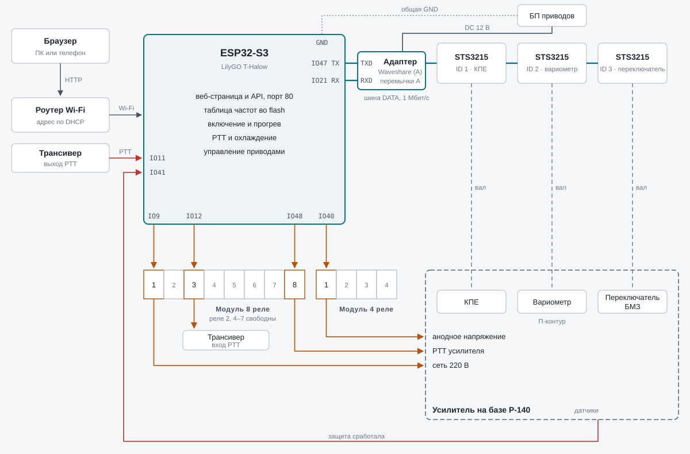
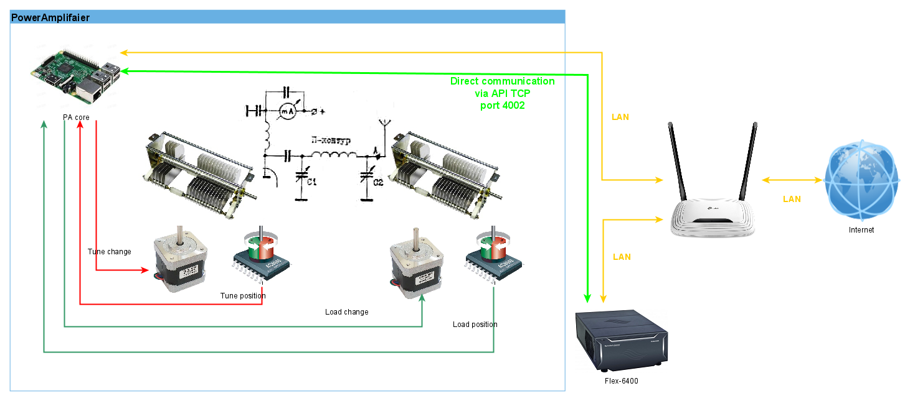

# RemoteTubeAmplifaier

[English version](README.en.md)



Схема с последовательностью включения и таблицей выводов: [docs/scheme.html](docs/scheme.html).

Контроллер лампового усилителя мощности на базе Р-140 на ESP32. Автоматически перестраивает
П-контур (КПЕ, вариометр, переключатель БМЗ) по выбранной частоте, управляет включением
усилителя и разрешением PTT. Работа и настройка — через веб-страницу, которую отдаёт сам контроллер.

> Проект в разработке. Логика и веб-интерфейс проверены на плате, но сервоприводы, реле и входы
> от усилителя к ней ещё не подключались — см. [Состояние проекта](#состояние-проекта).

## Возможности

- **Таблица частот** с шагом 25 кГц по любительским диапазонам 160–10 м, диапазонам 190 м (1600–1775 кГц) и 100 м (2900–3200 кГц); на странице показан один диапазон.
- **Перестройка по частоте**: при выборе частоты КПЕ, вариометр и переключатель БМЗ встают в сохранённые для неё положения. Выбор частоты и настройка — только при включённом и прогретом усилителе.
- **Режим настройки**: КПЕ и вариометр крутятся ползунками и кнопками ±1/±10/±100 шагов, БМЗ — кнопками 1–5; найденная настройка сохраняется для частоты.
- **Последовательность включения**: питание → прогрев ламп 3 минуты (управление заблокировано) → анодное напряжение → разрешение PTT. Плавный пуск в усилителе автономный, контроллер им не управляет.
- **PTT через контроллер**: PTT трансивера заведён на ESP32 и проходит на усилитель только после прогрева и без срабатывания защиты; на время перестройки по выбору частоты (КПЕ, вариометр, переключатель БМЗ) и без связи с любым из приводов PTT снимается; ручное вращение КПЕ и вариометра в режиме настройки PTT не снимает (настройка под несущей). На странице всегда видно, разрешена ли передача и почему нет.
- **Передача с веб-страницы**: кнопка «Передача» переводит трансивер на передачу (реле 3), только когда усилитель включён и прогрет; страница подтверждает передачу каждые 0,5 с, без подтверждения передача снимается через 2 с, дольше 60 с не держится.
- **Охлаждение**: если с последней передачи прошло меньше 5 минут, «Выключить» не выключает усилитель — появляется кнопка «Выключить без охлаждения».
- **Защита**: срабатывание запоминается, PTT запрещён до сброса с веб-страницы.
- **Состояние на странице**: этап включения с обратным отсчётом, питание, анодное, PTT и причина запрета, время последней передачи и отсчёт охлаждения, защита, связь с каждым сервоприводом.
- **Сервис**: поиск сервоприводов на шине, смена их ID, калибровка положения 1 переключателя БМЗ.
- **Хранение** настроек во flash-памяти ESP32; таблицу можно выгрузить в файл и загрузить обратно (перенос на другую плату).
- Вёрстка под компьютер и телефон.

## Железо

| Узел | Что используется |
|---|---|
| Контроллер | LilyGO T-Halow (ESP32-S3, 16 МБ flash); планируется переход на плату ESP32-S3 с Ethernet |
| КПЕ | сервопривод Feetech STS3215, ID 1 |
| Вариометр | сервопривод Feetech STS3215, ID 2 (вращается без ограничений) |
| Переключатель БМЗ | сервопривод Feetech STS3215, ID 3, 5 положений через 72°, без ограничителей |
| Коммутация | модуль на 8 реле с опторазвязкой + модуль на 4 реле |
| Сеть | Wi-Fi-клиент (адрес по DHCP); вариант с Ethernet на W5500 в прошивке есть, но не проверен |

Штатный разъём RJ45 на T-Halow принадлежит HaLow-модулю, ESP32 к нему доступа не имеет.

## Подключение

Выводы для T-Halow. Все реле включаются **низким** уровнем на входе модуля.

| Вывод ESP32 | Назначение |
|---|---|
| IO9 | реле 1 (модуль на 8): включение усилителя |
| IO12 | реле 3: PTT трансивера (передача с веб-страницы) |
| IO48 | реле 8: PTT усилителя |
| IO40 | реле 1 (модуль на 4): анодное напряжение |
| IO11 | вход PTT от трансивера (активен при замыкании на GND) |
| IO41 | вход «сработала защита» (активен при замыкании на GND) |
| IO47 | шина сервоприводов, передача (на `TXD` адаптера) |
| IO21 | шина сервоприводов, приём (на `RXD` адаптера) |

Реле 4–7 модуля на 8 реле и 2–4 модуля на 4 реле сейчас свободны. Выводы меняются константами в начале скетча.

### Шина сервоприводов

Все три STS3215 сидят на одной полудуплексной шине (1 Мбит/с): у привода два параллельных разъёма,
приводы соединяются цепочкой.

Приводы подключаются к ESP32 через адаптер Waveshare Bus Servo Adapter (A):

```
ESP32 IO47 (TX) ─── TXD ┐
ESP32 IO21 (RX) ─── RXD ├ адаптер (перемычки в положении A) ── разъём привода ── привод ── привод ── привод
ESP32 GND ───────── GND ┘                │
                                         └── DC 12 В (блок питания приводов)
```

- **TX к TXD, RX к RXD** — подписи на адаптере со стороны контроллера, это не ошибка.
- **Перемычки** на гребёнке из 6 контактов — в положении A: ряд RXD/TXD соединён со средним рядом (U1RXD/U1TXD). В положении B шиной управляет компьютер через USB-C адаптера (удобно для проверки приводов и смены ID).
- **Питание приводов** — блок на их напряжение (12 В для 12-вольтовых STS3215, по наклейке), с запасом по току (до 2–3 А на привод при заклинивании). Адаптер рассчитан на 9–12,6 В; при 14,5 В привод отвечает ошибкой напряжения. От ESP32 приводы не питать.
- **Общая земля** адаптера и ESP32 обязательна (контакт GND разъёма UART).
- Уровни на разъёме UART адаптера — 3,3 В, согласование не нужно. 5 В для ESP32 адаптер не выдаёт.

### Реле и входы

- Модули реле «для Arduino» рассчитаны на 5 В. Если реле срабатывают нечётко от 3,3 В, питайте сторону оптронов (VCC) от 3,3 В, а катушки (JD-VCC) — от 5 В, сняв перемычку.
- На входы IO11/IO41 нельзя подавать больше 3,3 В: PTT трансивера и сигналы от усилителя заводите через сухой контакт или оптрон на GND.

## Сборка и прошивка

Нужны [arduino-cli](https://arduino.github.io/arduino-cli/) (или Arduino IDE) и ядро ESP32 3.x
(`esp32:esp32`). Сторонние библиотеки не нужны.

1. Создайте файл `esp32-backend/secrets.h` (он в `.gitignore`):

   ```cpp
   #pragma once
   const char *WIFI_SSID = "имя сети";      // ESP32 работает только в 2,4 ГГц
   const char *WIFI_PASS = "пароль";
   ```

2. Соберите прошивку и залейте её вместе с файлами веб-страницы (`esp32-backend/data`) одной командой:

   ```bash
   tools/flash.sh               # собрать, залить прошивку и файлы страницы
   tools/flash.sh build         # только собрать
   tools/flash.sh firmware      # собрать и залить только прошивку
   tools/flash.sh www           # залить только файлы страницы
   tools/flash.sh monitor       # монитор порта
   tools/flash.sh -p /dev/ttyACM1 all   # другой порт
   ```

   Монитор порта перед заливкой нужно закрыть. Позже файлы можно обновлять без кабеля: блок «Сервис» на странице → «Загрузить файлы». Если файлов нет (например, после полной очистки flash), плата отдаёт запасную страницу с формой загрузки.

3. Откройте монитор порта (`tools/flash.sh monitor`) — плата напишет полученный от роутера адрес: `IP: 192.168.x.x`. Откройте его в браузере. Адрес удобно закрепить за платой в настройках роутера.

Для платы с Ethernet (W5500) поставьте `#define USE_ETHERNET 1` в начале скетча и укажите выводы `ETH_*`.

Скорость и ускорение сервоприводов — константы `SERVO_SPEED` и `SERVO_ACC`; длительности
прогрева и охлаждения — `WARMUP_MS` и `COOLDOWN_MS`.

> Сейчас для отладки прогрев и охлаждение сокращены до 10 с (`WARMUP_MS`, `COOLDOWN_MS`, помечены «ОТЛАДКА»).
> Перед работой с усилителем верните 180000 и 300000.

## Первый запуск

1. **ID сервоприводов.** С завода у всех приводов ID 1. Подключайте к шине по одному и в блоке «Сервис» на странице меняйте номер: вариометру — 2, переключателю БМЗ — 3. КПЕ остаётся на 1. Кнопка «Найти приводы» показывает, кто отвечает.
2. **Калибровка переключателя БМЗ.** В блоке «Сервис» ползунком и кнопками ±1/±10/±100 поверните переключатель точно в положение 1 и нажмите «Запомнить как положение 1».
3. **Настройка частот.** Включите «Режим настройки», выберите частоту, подберите КПЕ, вариометр и положение БМЗ, нажмите «Сохранить». Настроенные частоты помечены зелёной полоской.
4. **Резервная копия.** В режиме настройки кнопка «Скачать» сохраняет таблицу в файл `tubeamp-points.csv` (`частота;КПЕ;вариометр;БМЗ`), «Загрузить» — восстанавливает.

## HTTP API

Ответы — JSON. Положения сервоприводов — в шагах 0..4095 (4096 шагов на оборот).

| Метод | Назначение |
|---|---|
| `GET /api/state` | всё текущее состояние: частота, положения, режим, этап включения, реле, входы, PTT, связь с приводами |
| `GET /api/table` | диапазоны и точки `[частота, КПЕ, вариометр, сохранена, БМЗ]` |
| `POST /api/select?freq=<кГц>` | выбрать частоту |
| `POST /api/mode?tuning=0\|1` | режим настройки |
| `POST /api/move?cap=&vario=&sw=` | ручное управление (только в режиме настройки) |
| `POST /api/save`, `POST /api/reset` | сохранить или сбросить настройку текущей частоты |
| `GET /api/points.csv`, `POST /api/points.csv` | выгрузка и загрузка таблицы |
| `POST /api/power?on=0\|1[&force=1]` | включить или выключить усилитель; в течение 5 минут после передачи выключение — только с `force=1` |
| `POST /api/protection/reset` | сбросить сработавшую защиту |
| `POST /api/tx?on=1`, `?keep=1`, `?on=0` | передача с веб-страницы: начать, подтвердить (не реже раза в 2 с), закончить |
| `POST /api/www` | загрузить файлы веб-страницы (multipart) |
| `POST /api/servo/scan`, `POST /api/servo/id?from=&to=` | поиск приводов и смена ID |
| `POST /api/switch/move?pos=`, `POST /api/switch/jog?steps=`, `POST /api/switch/calibrate` | калибровка переключателя БМЗ |

## Состояние проекта

Проверено на T-Halow: подключение к Wi-Fi по DHCP, веб-страница, все методы API, сохранение
настроек во flash, логика последовательности включения и запрета PTT.

Не проверено на железе:
- работа с сервоприводами STS3215 (протокол реализован по документации Feetech), в том числе шаговый режим переключателя БМЗ;
- реле и входы PTT и защиты;
- вариант с Ethernet.

Не сделано: получение частоты от трансивера по CAT.

## Старая версия

Каталоги `py_server/`, `py_client/` и `common/` — предыдущее поколение проекта на Raspberry Pi с
шаговыми двигателями и платами Mechaduino, с перестройкой по частоте трансивера Flex-6400.
Новые задачи в нём не развиваются.


